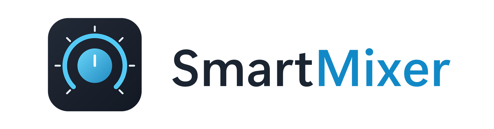

<p align="center">
  <picture>
    <source media="(prefers-color-scheme: dark)" srcset="./assets/SmartMixerWhite.png">
    
  </picture>
</p>

<p align="center">
  <b>Seven-channel hardware mixer for Windows</b><br/>
  Turn real knobs into per-application volume — native, lightweight and open source
</p>

<p align="center">
  
  
  
  
  
  <a href="https://github.com/bryanrafaelbueno/SmartMixer/actions/workflows/ci.yml"></a>
</p>

---

## 📦 Download (Release)

👉 A compiled **version is available on GitHub Releases**.

Download the Windows installer (and the signed Firefox add-on) without building
anything from source:

➡️ **https://github.com/bryanrafaelbueno/SmartMixer/releases**

Every release is built automatically from a `v*` tag: the MSI bundles the
application, the Firefox bridge, the firmware and AVRDUDE, and ships with
SHA-256 checksums.

---

## ✨ What is SmartMixer?

**SmartMixer** turns an Arduino Pro Micro board into a **seven-channel hardware
mixer for Windows**. Each potentiometer is bound to an application — or a
Firefox tab — and controls its volume in real time through the Windows Audio
Session API.

It runs silently in the background (notification area), detects audio sessions
automatically, and keeps everything in sync: profiles, calibrations, LEDs and
the Firefox bridge all update live.

💡 Ideal if you want a physical mixer for your PC without buying closed
hardware or installing heavyweight software.

---

## 🚀 Features

- 🎛️ **Seven physical channels** — potentiometers, channel LEDs and a touch
  sensor on an Arduino Pro Micro (ATmega32U4, 16 MHz);
- 🔊 **Per-application volume** through Windows Audio Sessions (NAudio / Core
  Audio), including mute state and active-session discovery;
- 🔀 **Automatic, Fixed and Hybrid** channel assignment plus seven ordering
  modes;
- 🗂️ **Profiles** — duplicate, rename, remove, select, default, import/export,
  with automatic switching rules per application;
- 🦊 **Firefox integration** — per-tab volume and mute for the browser, with the
  touch sensor toggling between Applications and Firefox modes;
- 🎚️ **Calibration** — capture physical endpoints per knob, deadzone,
  smoothing, sensitivity, per-channel inversion and soft takeover;
- 🔌 **Robust serial link** — sequence validation, dropped-packet accounting,
  firmware version probe, automatic reconnect and ping/latency telemetry;
- 🧊 **Acrylic volume overlay** — confirmation HUD that never steals focus,
  with position, duration and content options;
- 📥 **Notification-area icon** — open pages, switch profiles, reconnect the
  Arduino or exit without opening the window;
- 🚀 **Starts with Windows** — optional startup (MSIX startup task or the user
  Run key for unpackaged builds) and start-minimized mode;
- 🛠️ **First-run setup** — wizard for port selection, firmware upload
  (bundled AVRDUDE) and calibration, delivered as a WiX 5 MSI that also
  registers the Firefox Native Messaging Host;
- 🌙 **Fluent design** — Mica window, Fluent icons, Segoe UI Variable and a
  light/dark/system theme.

---

## 🧠 How it works

```text
You turn a knob
      ↓
The Pro Micro streams telemetry (D,<sequence>,…,<touch>) ~33×/second
      ↓
SmartMixer parses the frame, applies calibration, deadzone and smoothing
      ↓
The channel's application volume is set through Windows Core Audio
      ↓
The acrylic overlay confirms the change · the channel LED shows assignment
```

---

## 🔩 Hardware

| Part | Notes |
|---|---|
| Arduino Pro Micro (ATmega32U4 @ 16 MHz) | Other AVR boards work if you adjust the firmware pin map |
| 7 × linear potentiometers | 10 kΩ recommended, 5 V reference |
| 7 × LEDs (+ resistors) | Channel assignment feedback |
| 1 × touch sensor | Active-high by default; `TOUCH_ACTIVE_LOW` for active-low modules |

Default pin map:

| Function | Arduino pin |
|---|---|
| Potentiometers 1–7 | A0, A1, A2, A3, A6, A7, A8 |
| LEDs 1–7 | D2, D3, D5, D7, D14, D15, D16 |
| Touch sensor | D9 |

The full frame reference (telemetry, commands, timing, resync rules) is in
[docs/PROTOCOL.md](docs/PROTOCOL.md).

---

## 📁 Project structure

```text
smartmixer/
├── .github/                     CI, tagged releases, issue and PR templates
├── assets/                      README wordmark (dark and light themes)
├── docs/                        Serial protocol reference
├── firefox/
│   ├── extension/               WebExtension source (tab audio → app)
│   ├── native-host/             Native Messaging Host (C#)
│   └── signed/                  Mozilla-signed XPI bundled by the MSI
├── firmware/SmartMixerProMicro/ Arduino firmware (ATmega32U4, 16 MHz)
├── installer/                   WiX 5 MSI packaging + first-run payload
├── scripts/                     Registration, packaging and release helpers
├── src/
│   ├── SmartMixer/              WinUI 3 app, Core Audio, serial, tray, overlay
│   ├── SmartMixer.Core/         Project that compiles the shared core
│   └── SmartMixer/Core/         Platform-free core (models, config, engine)
├── tests/SmartMixer.Tests/      xUnit tests
└── SmartMixer.sln
```

---

## 🖥️ Installation

### Installer (recommended)

1. Download `SmartMixerSetup.msi` from
   [Releases](https://github.com/bryanrafaelbueno/SmartMixer/releases).
2. Run it. The first-run wizard opens automatically and guides you through:
   - selecting the Arduino COM port;
   - flashing the firmware (only for ATmega32U4 @ 16 MHz boards, with explicit
     confirmation);
   - calibrating all seven potentiometers;
   - registering the Firefox Native Messaging Host.
3. In the app, go to **Hardware**, refresh the ports and click **Connect**.

> Firefox does not allow installing an extension silently without Mozilla
> signing. The wizard lets you select a signed `.xpi` or open the add-ons
> website; without it the app still works with Windows applications only.

### From source

Prerequisites:

| Dependency | Version |
|---|---|
| Windows | 11 x64 (technically Windows 10 1809+) |
| .NET SDK | 8.0 |
| Visual Studio | 2022 with WinUI 3 / Windows App SDK and a Windows SDK |
| Arduino IDE or CLI | 2.x, only to flash the firmware |
| Firefox | 140+ on desktop to use the browser integration |

```powershell
git clone https://github.com/bryanrafaelbueno/SmartMixer
cd SmartMixer

# Unit tests
dotnet test .\tests\SmartMixer.Tests\SmartMixer.Tests.csproj

# WinUI 3 app (Developer PowerShell)
MSBuild.exe .\src\SmartMixer\SmartMixer.csproj /restore /p:Configuration=Release /p:Platform=x64
```

Or open `SmartMixer.sln` in Visual Studio and press F5.

### MSIX (developers)

The repository also contains an MSIX single-project for Windows Desktop with
its own assets and the Windows startup task declaration. Build it from Visual
Studio; the package is unsigned by default. For local sideloading, create a
development certificate whose subject matches the `Publisher` in
`Package.appxmanifest` and set its thumbprint:

```powershell
$certificate = Get-ChildItem Cert:\CurrentUser\My |
    Where-Object { $_.Subject -eq "CN=SmartMixer Development" -and $_.HasPrivateKey } |
    Select-Object -First 1
if (-not $certificate) {
    $certificate = New-SelfSignedCertificate -Type CodeSigningCert `
        -Subject "CN=SmartMixer Development" -CertStoreLocation Cert:\CurrentUser\My
}
MSBuild.exe .\src\SmartMixer\SmartMixer.csproj /restore /p:Configuration=Release /p:Platform=x64 `
    /p:AppxPackageSigningEnabled=true /p:PackageCertificateThumbprint=$($certificate.Thumbprint)
```

---

## 🎛️ First run

1. Plug in the Arduino and open **Hardware**; refresh the port list, select the
   COM port and connect. The port and baud rate are persisted.
2. In **Channels**, choose **Automatic**, **Fixed** or **Hybrid** and pin the
   applications that must never move.
3. Calibrate the physical endpoints in **Calibration** (or in the wizard):
   capture 0% and 100% for every pot; soft takeover is on by default.
4. Turn on **Start with Windows** and **Start minimized** in **Settings** if
   you want the mixer resident after boot.
5. Closing or hiding the window keeps the runtime in the notification area;
   **Exit** stops the services, saves the configuration and closes the overlay.

---

## ⚙️ Configuration and data

| Data | Location |
|---|---|
| Configuration and profiles | `%LOCALAPPDATA%\SmartMixer\configuration.json` |
| Structured log | `%LOCALAPPDATA%\SmartMixer\logs\smartmixer.log` |
| Native host registration | `%LOCALAPPDATA%\SmartMixer\FirefoxNativeHost` (per-user) |

The **Diagnostics** page keeps the last 1000 log lines in memory and can export
them. **Copy diagnostics** excludes personal file paths and includes the
Windows version, port, counters, active profile and recent errors.

---

## 🔀 Channel assignment

| Mode | Behavior |
|---|---|
| **Automatic** | Channels always receive the first applications from the ordered pool. |
| **Fixed** | Only pinned applications are used; nothing moves automatically. |
| **Hybrid** | Pinned applications stay put, the remaining channels are filled automatically. |

Ordering modes: **Alphabetical**, **Recently opened**, **Most recently used**,
**Playing audio**, **Foreground first**, **Audio activity** and **Custom
priority** (per-application priorities).

## 🗂️ Profiles

Profiles store assignment mode, ordering, channel bindings, priorities,
detection filters, Firefox settings and overlay preferences. You can duplicate,
rename and remove them, import/export the whole configuration, and set a default
profile. When **profile automation** is enabled, rules switch the active profile
while specific applications are running — the default profile is restored when
none match.

## 🦊 Firefox integration

The WebExtension shares each tab's title, domain, favicon and audio state with
the companion app through the Native Messaging Host, and the app answers with
volume/mute commands for individual tabs. A local named pipe connects the host
to the mixer — nothing leaves your machine.

Setup:

1. The MSI wizard registers the host automatically. For MSIX or development
   builds, publish the host and register it per user:

   ```powershell
   .\scripts\Install-FirefoxHost.ps1 -ExecutablePath "<publish folder>\SmartMixer.NativeHost.exe"
   ```

2. Restart Firefox. Without the signed extension, load the unpacked extension
   from `about:debugging#/runtime/this-firefox` (select
   `firefox/extension/manifest.json`).

The touch sensor toggles between Applications and Firefox modes (configurable
per profile). In Firefox mode the assigned LEDs pulse.

### Privacy

The extension declares
`browser_specific_settings.gecko.data_collection_permissions.required:
["browsingActivity"]` because it shares tab titles, domains, favicons and audio
state with the companion app via Native Messaging and a local named pipe. This
data — and the stable tab identifier — is handled only locally: it is **not
sent to remote services** and is **not stored as history**. The extension needs
`tabs`, `scripting` and `<all_urls>` to enumerate tabs and adjust `<audio>`/
`<video>` elements in the page.

---

## 🎚️ Calibration

- Capture 0% and 100% for each potentiometer; left or right can represent 100%.
- **Deadzone** filters mechanical slack, **smoothing** stabilizes jittery
  readings and **sensitivity** shapes the response curve.
- **Soft takeover** means a knob only grabs its application after passing the
  current volume, preventing jumps.
- Direction can be inverted per channel; input state resets when the
  assignment changes.

---

## 🧱 Stack

| Layer | Technology |
|---|---|
| UI | WinUI 3 / Windows App SDK 1.6, Mica, Acrylic |
| Audio | NAudio (WASAPI / Core Audio sessions) |
| Serial | `System.IO.Ports`, 115200 8N1 custom protocol |
| Runtime | .NET 8 (C# 12) |
| Firmware | Arduino (ATmega32U4 @ 16 MHz) |
| Browser bridge | Manifest V2 WebExtension + Native Messaging + named pipe |
| Packaging | WiX 5 MSI (bundles firmware + AVRDUDE), MSIX single-project |
| Tests | xUnit |
| CI/CD | GitHub Actions (build, tests, tagged releases) |

---

## 🛠️ Building the release artifacts

From a Developer PowerShell with MSBuild, internet access and the WiX tooling:

```powershell
# Full MSI (app + Firefox bridge + firmware + bundled signed XPI)
.\installer\Build-Msi.ps1 -FirefoxXpiPath .\firefox\signed\SmartMixer.signed.xpi

# Extension ZIP for AMO (manifest.json and background.js at the ZIP root)
.\scripts\Build-FirefoxExtension.ps1
```

The MSI is written to `installer\dist\Release\SmartMixerSetup.msi`. The build
restores WiX 5.0.2, downloads Arduino CLI 1.3.1 and the official Arduino AVR
Boards 1.8.6 package, compiles the firmware for `arduino:avr:micro` and
publishes the self-contained WinUI app and native host.

Releases are automated: pushing a `v*` tag runs the **Release** workflow, which
stamps the version into the manifests, builds everything and publishes the MSI,
the extension ZIP and `SHA256SUMS.txt` on GitHub Releases.

---

## 🧪 Tests

```powershell
dotnet test .\tests\SmartMixer.Tests\SmartMixer.Tests.csproj
```

The suite covers the serial frame parser and calibration normalization, the
configuration store (validation, import/export, selection repair), the
assignment engine (Automatic/Fixed/Hybrid with all orderings) and Firefox tab
ordering. CI runs the tests on every push and pull request.

---

## 🩺 Troubleshooting

- **The COM port does not appear** — check the data cable and the board driver.
  Close the Arduino Serial Monitor; the port is exclusive.
- **"Access denied" when opening the port** — another process still holds the
  COM port; close serial monitors and terminal apps.
- **Firefox does not connect** — verify the extension is installed and enabled,
  the host is registered for the current user (see **Diagnostics**) and restart
  Firefox after registration.
- **SmartScreen warns about the MSI** — release binaries are not code-signed;
  sign the MSI with a trusted publisher certificate for distribution.
- **The firmware upload fails** — confirm an ATmega32U4 @ 16 MHz board, enter
  the bootloader manually and pick the temporary port that appears.

## ⚠️ Limitations

- Windows controls volume per audio session/process: applications that share a
  single process/session share the same volume. Processes without an audio
  session are not discovered yet.
- Saved identities prefer the executable path and process session ID; automatic
  profile rules are evaluated against detected audio sessions.
- Firefox internal pages and some restricted origins cannot be injected; the
  extension adjusts `<audio>`/`<video>` volume and does not offer gain above
  100%. It is not a native per-tab volume API.
- The overlay implements the flyout on the primary monitor only
  (center/top/bottom); other monitors and per-process detection without audio
  are on the roadmap.
- Latency diagnostics measure the serial ping round-trip and do not include
  Core Audio latency.

---

## 🤝 Contributing

Contributions are welcome! See [CONTRIBUTING.md](CONTRIBUTING.md) for the
development setup, test commands and commit conventions. Please use the issue
templates for bugs and feature requests.

---

## 📄 License

MIT © SmartMixer Contributors

---

## ☕ Support the project

If this project helps you, consider supporting development: </br>
<a href="https://www.buymeacoffee.com/bryanrafaelbueno" target="_blank"></a> </br>

---

<p align="center">
<a href="https://feitonobrasil.dev.br" aria-label="Feito no Brasil">
  
</a>
</p>
